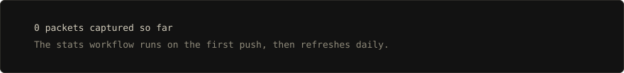

Full-stack developer and automation engineer, studying Computer Science at Lovely Professional University. I work on scalable backends, network security tooling and automation, mostly in React, Spring Boot and Python, on Arch Linux with Hyprland.

**Open to opportunities.** The [portfolio](https://gurvinders-folio.vercel.app/) has the long version.

## Stack

Solid is what I use every day. Outlined is what I'm learning.

| Area | Tools | Used for |
| --- | --- | --- |
| Frontend | React 19, Vite, GSAP, Tailwind | Interactive, motion-rich interfaces |
| Backend | Spring Boot, FastAPI, Node | Clean, production-ready APIs |
| Security and systems | Scapy, Linux, eBPF (learning) | Detection, monitoring, hardening |

## Projects

| Project | What it does | Built with |
| --- | --- | --- |
| [wifi-deauth-defender](https://github.com/gurvindersingh-web/wifi-deauth-defender) | Detects WiFi deauthentication attacks. A 7-signal heuristic engine with adaptive baselines, AI classification through NVIDIA NIM, and a React dashboard. | Python, Scapy, FastAPI, React, Docker |
| [DevLancr](https://github.com/gurvindersingh-web/devlancr) | Freelance marketplace where clients find developers and developers show their work, with a client/freelancer toggle. | React 19, GSAP, Three.js, Spring Boot, JWT, WebSockets |
| [Spatiotemporal climate anomaly detection](https://github.com/gurvindersingh-web/Spatiotemporal-climate-anomaly-detection-AI) | Map and search interface that flags climate anomalies in Open-Meteo data using z-scores. | React, Vite, Leaflet, n8n |
| [SCIES](https://github.com/gurvindersingh-web/systm-security) | System Call Interface for Enhanced Security. A simulator that walks a syscall through init, authentication, ACL and execution, with configurable ACLs, attack scenarios and audit logging. | React 19, Vite |
| [Dynamic memory management](https://github.com/gurvindersingh-web/Dynamic-Memory-Management) | Animated FIFO, LRU and Optimal page replacement, with TLB simulation, working-set tracking and Belady's anomaly. | JavaScript |
| [OS process analyzer](https://github.com/gurvindersingh-web/OS-process-analizer) | Workload generator for testing OS performance. Simulates CPU, memory and disk stress with configurable load patterns and real-time monitoring. | Python |
| [Turn-based RPG battle engine](https://github.com/gurvindersingh-web/Turn-base-text-RPG-battle-engine) | Star Wars console RPG with attack, defend and heal, critical hits, scaling enemies and a boss fight in ASCII art. | Java 21, Maven |

## Activity

<picture>
  <source media="(prefers-color-scheme: dark)" srcset="https://raw.githubusercontent.com/gurvindersingh-web/gurvindersingh-web/output/github-contribution-grid-snake-custom.svg"/>
  <source media="(prefers-color-scheme: light)" srcset="https://raw.githubusercontent.com/gurvindersingh-web/gurvindersingh-web/output/github-contribution-grid-snake.svg"/>
  
</picture>

## Contact

- Email: [gurvindersingh.828384@gmail.com](mailto:gurvindersingh.828384@gmail.com)
- LinkedIn: [gurvinder-singh-01web](https://www.linkedin.com/in/gurvinder-singh-01web)
- Portfolio: [gurvinders-folio.vercel.app](https://gurvinders-folio.vercel.app/)

